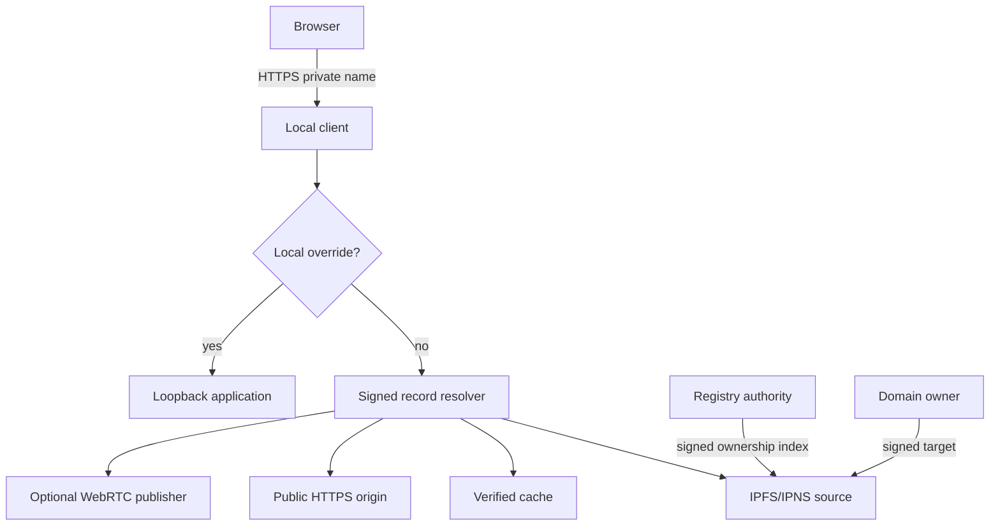

# ALT Architecture

**Status:** evolving implementation contract  
**Default network:** `.alt`  
**Core principle:** the engine is reusable; `.alt` is one network profile.

## 1. Purpose

ALT provides local-first HTTPS development and signed name resolution for private DNS namespaces. The official distribution operates `.alt`; the open-source engine lets independent operators create another network with its own TLD, trust root, registry, and IPFS/IPNS root.

ALT is not public DNS. A compatible client is required. Independent networks are not automatically globally unique or mutually trusted.

## 2. System view



The browser connects to loopback TLS. The client terminates browser TLS with a device-local CA and proxies to a local app, verified HTTPS origin, or authenticated WebRTC publisher. Local overrides always win and never mutate network records.

## 3. Network profile

Every independent network has a versioned profile:

```yaml
version: 1
networkId: alt-main-v1
tld: alt
registryKeys:
  - id: registry-2026
    publicKey: ed25519:BASE64
resolver:
  ipnsRoot: k51...
  gateways: []
reservedNames: [register]
```

The network ID is included in signed protocol messages. Resolver endpoints provide transport, not authority. The upstream binary defaults to `.alt`, but reusable packages accept an explicit namespace.

## 4. Local HTTPS

The client contains a namespace-scoped DNS stub, device-local constrained CA, SNI certificate issuer, loopback HTTPS proxy, CLI IPC endpoint, local override table, and verified record cache.

The daemon does not run as root. Any production helper for port 443 or resolver configuration is minimal and reversible. Foreground development uses an explicit high port and does not imply OS integration.

## 5. Site configuration

```yaml
version: 1
sites:
  app.alt:
    routes:
      - match: /api/*
        upstream: http://127.0.0.1:8080
      - match: /*
        upstream: http://127.0.0.1:3000
```

Custom networks use their configured TLD. Routes select a loopback HTTP upstream or static directory. Parsing is strict: duplicate keys, aliases, merge keys, custom tags, unknown fields, invalid paths, and non-loopback upstreams are rejected.

## 6. Signed records

The registry authority signs ownership records; owners sign targets. Both contain schema, network ID, canonical domain, generation/sequence, validity window, key identifiers, and signatures. Clients persist the highest generation and sequence. Stale providers can never lower accepted state.

## 7. IPFS/IPNS distribution

IPFS distributes content-addressed records; IPNS points to the current signed index. Neither nodes nor gateways define ownership.

Resolution order:

1. local override;
2. valid verified cache;
3. configured root pointer;
4. manifest/shard fetch by CID;
5. content, network, TLD, signature, rollback, and time verification;
6. atomic cache update;
7. target dispatch.

The first vertical slice may use a fixed CID. IPNS follows after fixed-CID verification is deterministic.

## 8. HTTPS and P2P targets

HTTPS targets use the origin's real hostname and strict TLS verification. The client rejects private/special-use destinations, revalidates redirects, and prevents DNS rebinding.

P2P uses WebRTC DataChannels. Signaling carries short-lived control messages, not site traffic. Publisher identity is bound to the session transcript and DTLS fingerprint. P2P is outside the first local + IPFS slice.

## 9. Registry bootstrap

`register.alt` is reserved on the official network and is published through the same signed path as other names. External login may still require a public Internet origin; `register.alt` cannot be its own only bootstrap dependency. A custom network may reserve `register.mesh` or an equivalent name.

## 10. Trust boundaries

- The local CA key is device-local.
- The registry key assigns names but does not sign owner target changes.
- The owner key controls targets for one ownership generation.
- IPFS/IPNS/gateways provide availability, not authority.
- Signaling provides rendezvous, not identity.
- TURN relays traffic, not trust decisions.
- The local client is a trusted TLS-terminating proxy.

## 11. Open-source boundary

Reusable core: namespace policy, DNS, local CA/TLS, routing, signed records, resolver/cache, and optional P2P transport.

ALT distribution: `.alt` profile, official keys/root, `register.alt`, hosted services, branding, and policy.

Forks must use their own network ID and keys. Changing only the TLD is insufficient because records must not be replayable across networks.

## 12. Implementation status

Implemented and tested:

- strict config parsing;
- proxy/static routing;
- local CA and leaf certificates;
- DNS packet responses;
- ownership/target signatures and rollback checks;
- bounded WebRTC DataChannel adapter;
- configurable namespace primitives.

In progress:

- foreground local run;
- versioned network profile;
- IPFS record source;
- `register.alt` bootstrap fixture;
- resolver integration.

Planned:

- production installer/daemon;
- public registry and identity;
- IPNS replication;
- secure public HTTPS proxy;
- signaling/P2P orchestration;
- operational release and recovery systems.

