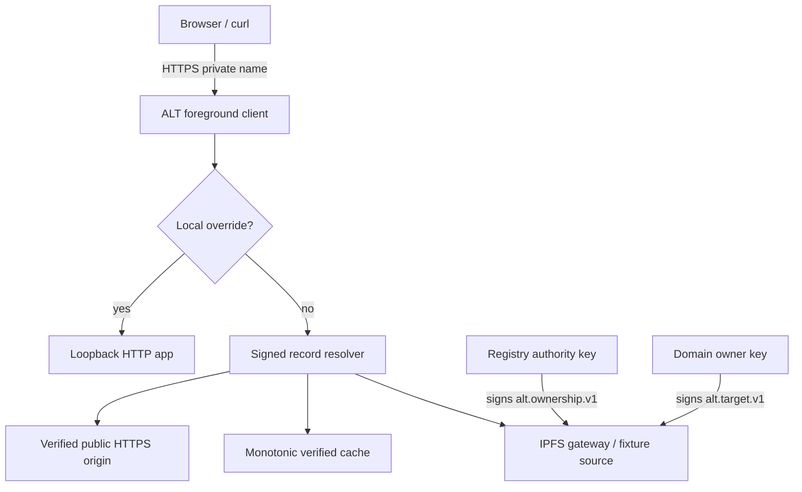

# ALT — An Alternative Universe for the Web (`.alt`)

> **`.alt` — Local-first HTTPS development and signed private-namespace web resolution.**

ALT enables developers to run local HTTPS applications under `.alt` domains (e.g., `https://register.alt` or `https://local.alt`) with zero account requirements, and resolve signed domain ownership and target records from content-addressed IPFS manifests.

The repository is built as a **reusable private-namespace engine**. `.alt` is the default upstream network profile, not a hardcoded requirement: independent operators can launch their own private TLD (such as `.mesh`) with a distinct `networkId`, registry authority keys, IPFS/IPNS root, reserved names, and branding. Independent networks are not automatically globally unique or mutually trusted.

> **Important scope notice:** This repository delivers an honest, non-privileged vertical slice. It **does not** claim production-grade OS installation, automatic `/etc/resolver` or system keychain mutation, global availability, or immediate certificate/record revocation.

---

## Feature Status Matrix

| Capability | Status | Package / Command | Notes |
| --- | --- | --- | --- |
| Namespace policy & single-label validation | **Implemented** | `pkg/names` | Single source of truth for TLD and domain checks |
| Versioned network profile (`networkId`, keys, TLD, root) | **Implemented** | `pkg/profile` | Strict YAML AST validation; prevents cross-network replay |
| Constrained device-local CA & SNI leaf issuance | **Implemented** | `pkg/pki` | ECDSA P-256 Root CA with `PermittedDNSDomains` limited to TLD |
| Authoritative loopback UDP DNS stub | **Implemented** | `pkg/dnsstub`, `alt run --dns-listen` | Answers configured TLD only; returns `REFUSED` for all other names |
| Strict `alt.yaml` v1 config & segment-aware router | **Implemented** | `pkg/config`, `pkg/router` | Loopback-only upstreams, safe static serving, symlink-escape protection |
| Ed25519 ownership & target records (`networkId`-bound) | **Implemented** | `pkg/records` | Domain-separated signatures with `networkId` prefix + monotonic sequence |
| Content-addressed IPFS manifest resolver & cache | **Implemented** | `pkg/resolver` | Verifies raw CIDv1 SHA-256 before JSON decode; monotonic anti-rollback |
| Foreground local HTTPS + DNS + IPFS fallback CLI | **Demo** | `cmd/alt` (`alt run`) | Non-privileged high-port listener; graceful `SIGINT`/`SIGTERM` drain |
| `register.alt` bootstrap generator & loopback IPFS server | **Demo** | `cmd/alt-bootstrap-gen`, `cmd/alt-demo-gateway` | Generates external `0600` dev keys and public `examples/demo-bootstrap` |
| WebRTC DataChannel `net.Conn` / `net.Listener` transport | **Beta** | `pkg/p2p/dcnet` | 16 KiB framing, 256 KiB send ceiling, 16-channel session budget |
| Mutable IPNS root resolution & multi-provider pinning | **Planned** | — | Current slice uses deterministic fixed manifest CIDv1 |
| Live WebRTC signaling service & `alt publish` P2P orchestration | **Planned** | — | DataChannel transport ready; signaling rendezvous planned |
| Privileged OS setup (`alt setup`, port 443, `/etc/resolver`) | **Planned** | — | Manual one-time trust/DNS steps documented below |
| Hosted `register.alt` GitHub login, quotas, and account recovery | **Planned** | — | Out of scope for current slice |

---

## Architecture Overview



See [ARCHITECTURE.md](ARCHITECTURE.md) for trust boundaries and [PLAN.md](PLAN.md) for the delivery checklist.

---

## Project Layout

```text
.
├── cmd/
│   ├── alt/                  # CLI entry point (`alt run`, `alt config validate`, etc.)
│   ├── alt-bootstrap-gen/    # Generates non-production dev keys outside repo & signs manifest/profile
│   └── alt-demo-gateway/     # Loopback HTTP IPFS raw-block gateway for offline/local verification
├── examples/
│   └── demo-bootstrap/       # Public demo profile.yaml + content-addressed manifest.json (no private keys)
├── pkg/
│   ├── config/               # Strict alt.yaml v1 parser, AST checker, and semantic validator
│   ├── daemon/               # Local override precedence, SSRF-guarded HTTPS target proxy, error mapping
│   ├── dnsstub/              # Authoritative UDP DNS stub for configured TLD queries
│   ├── errors/               # Canonical machine-readable ALT error codes
│   ├── names/                # Canonical TLD and domain normalization/validation
│   ├── p2p/dcnet/            # Pion WebRTC DataChannel net.Conn, net.Listener, and backpressure contract
│   ├── pki/                  # Device-local Root CA and on-demand SNI leaf certificate issuer
│   ├── profile/              # Versioned network profile schema and strict YAML loader
│   ├── records/              # Ed25519 networkId-bound canonical signing and verification
│   ├── resolver/             # Raw CIDv1 verification, IPFS HTTP gateway source, and monotonic cache
│   └── router/               # Segment-aware path router, loopback reverse proxy, and safe static/SPA server
├── ARCHITECTURE.md
├── CONTRIBUTING.md
├── CODE_OF_CONDUCT.md
├── LICENSE                   # Apache-2.0 (code & docs)
├── LICENSE-DOCS-CC-BY-4.0    # CC BY 4.0 full legalcode (dual-licensed docs)
├── NOTICE                    # Dual-license summary, trademark & trust-root notice
├── PLAN.md
└── SECURITY.md
```

---

## End-to-End Demo Walkthrough

### 1. Run the Test Suite

```bash
go test ./...
go test -race ./...
go vet ./...
```

### 2. Local Override Route (`alt run register.alt --port 3000`)

Start any local HTTP server on port `3000` (for example `python3 -m http.server 3000 --bind 127.0.0.1`), then run:

```bash
go run ./cmd/alt run register.alt \
  --port 3000 \
  --listen 127.0.0.1:8443 \
  --dns-listen 127.0.0.1:15353 \
  --state-dir /tmp/alt-demo-state \
  --profile examples/demo-bootstrap/profile.yaml
```

Verify HTTPS routing (using the generated namespace-constrained CA) and the local DNS stub without modifying your OS:

```bash
curl -i --resolve register.alt:8443:127.0.0.1 \
  --cacert /tmp/alt-demo-state/ca.crt \
  https://register.alt:8443/

dig @127.0.0.1 -p 15353 register.alt A
```

Notice `X-Alt-Resolution: local-override` in the HTTP response headers.

### 3. Removing the Local Override → Verified IPFS Resolution of `register.alt`

#### Option A: Using a local Kubo IPFS node (if `ipfs` is installed)

```bash
# Import the raw manifest block and verify its CIDv1 matches profile.yaml:
ipfs block put --cid-codec raw --mhtype sha2-256 examples/demo-bootstrap/manifest.json
# Expected CID: bafkreibwn5a377xoxrx3coliwddaptc27t67nizuwvtkmdnawmglqdjnce
```

Then start `alt run` without `--port`, pointing `--gateways` to your local IPFS gateway (e.g., `http://127.0.0.1:8080`).

#### Option B: Using the built-in loopback IPFS raw-block gateway (no external daemon needed)

Terminal 1 — start the loopback IPFS gateway serving `examples/demo-bootstrap/manifest.json`:

```bash
go run ./cmd/alt-demo-gateway \
  --listen 127.0.0.1:18080 \
  --manifest examples/demo-bootstrap/manifest.json
```

Terminal 2 — run `alt run` **without** `--port` (removing the local override so `daemon.Engine` falls back to IPFS resolution):

```bash
go run ./cmd/alt run \
  --listen 127.0.0.1:8443 \
  --state-dir /tmp/alt-demo-state \
  --profile examples/demo-bootstrap/profile.yaml
```

Terminal 3 — query `https://register.alt:8443/`:

```bash
curl -i --resolve register.alt:8443:127.0.0.1 \
  --cacert /tmp/alt-demo-state/ca.crt \
  https://register.alt:8443/
```

`ALT` fetches `bafkreibwn5a377xoxrx3coliwddaptc27t67nizuwvtkmdnawmglqdjnce` from `http://127.0.0.1:18080/ipfs/<cid>?format=raw`, verifies the SHA-256 CIDv1 digest prior to JSON parsing, verifies the `alt-dev-demo-v1` Ed25519 authority and owner signatures, caches the verified record monotonically, and proxies to the signed target (`X-Alt-Resolution: verified-record`).

### 4. Regenerating Non-Production Bootstrap Keys & Manifest

Private keys must **never** be stored inside the repository. `cmd/alt-bootstrap-gen` enforces an external `--keys-dir` (`0700` directory, `0600` key files) and writes only public keys and the CIDv1 into `examples/demo-bootstrap`:

```bash
go run ./cmd/alt-bootstrap-gen \
  --keys-dir "$HOME/.config/alt/dev-demo-keys" \
  --out-dir examples/demo-bootstrap \
  --network-id alt-dev-demo-v1 \
  --tld alt \
  --domain register.alt \
  --key-id dev-demo-registry-2026-not-for-prod \
  --target https://example.org \
  --gateway http://127.0.0.1:18080
```

### 5. Optional One-Time macOS Browser Trust & DNS Setup (Manual & Reversible)

`alt run` never touches `/etc`, Keychain, or `launchd`. If you want `https://register.alt` to resolve directly in a local browser during manual testing:

1. **Trust the generated namespace-constrained CA** (constrained via X.509 `PermittedDNSDomains` to `.alt` only):
   ```bash
   sudo security add-trusted-cert -d -r trustRoot -k /Library/Keychains/System.keychain /tmp/alt-demo-state/ca.crt
   ```
2. **Create `/etc/resolver/alt`** pointing to your `--dns-listen` UDP port (and forward loopback TCP `443` via `pfctl` if not specifying `:8443`):
   ```bash
   sudo mkdir -p /etc/resolver
   printf "nameserver 127.0.0.1\nport 15353\n" | sudo tee /etc/resolver/alt
   ```
3. **Remove when finished:**
   ```bash
   sudo rm -f /etc/resolver/alt
   sudo security delete-certificate -c "ALT Device Local Root CA" /Library/Keychains/System.keychain
   ```

---

## Licensing & Brand Notice

- **Source Code:** Licensed under the [Apache License, Version 2.0](LICENSE).
- **Documentation:** Dual-licensed under [Apache-2.0](LICENSE) and [CC BY 4.0](LICENSE-DOCS-CC-BY-4.0) (https://creativecommons.org/licenses/by/4.0/).
- **Trademarks & Official Trust Root:** The "ALT" name and logos are excluded brand assets. The official `.alt` network profile, production registry keys, and hosted services are an operational trust root separate from the open-source engine. See [NOTICE](NOTICE) for details.
