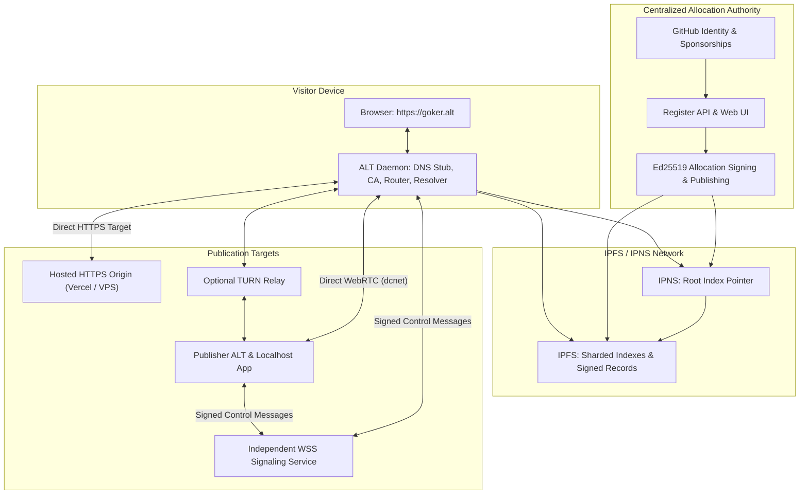

# ALT — An Alternative Universe for the Web (`.alt`)

> **`.alt` — Local-first HTTPS development and peer-to-peer / direct-origin web publishing.**

ALT enables developers to run local HTTPS applications under `.alt` domains (e.g., `https://goker.alt` or `https://local.alt`) with zero account requirements, and optionally publish registered `.alt` domains either directly from localhost over WebRTC DataChannels or via signed HTTPS origin records.

The repository is designed as a reusable private-namespace engine. `.alt` is the
default network, not a hard requirement: independent operators can configure a
different TLD and provide their own network ID, registry authority keys, record
root, services, and policies. Independent networks are not automatically
globally unique or mutually trusted.

> **Implementation status:** this repository is an early vertical slice, not a
> production release. Local routing, certificates, DNS packets, signed records,
> and the DataChannel adapter are implemented. Registry hosting, IPFS/IPNS
> orchestration, production installers, and complete P2P publishing are still in
> progress. See [PLAN.md](PLAN.md) and [ARCHITECTURE.md](ARCHITECTURE.md).

---

## Architecture Overview



### Core Design Principles

1. **Zero-Config Local HTTPS (`alt dev`):** Uses a device-scoped ECDSA P-256 Root CA constrained to `.alt` (`pkg/pki`), a local DNS stub answering only `.alt` queries (`pkg/dnsstub`), and a loopback HTTPS reverse proxy (`pkg/router`, `pkg/daemon`).
2. **Decentralized Resolution (`pkg/records`):** Domain allocations (`alt.ownership.v1`) are signed by the Registry Authority (`Ed25519`), while target routing records (`alt.target.v1`) are signed by the domain owner's key and distributed via IPFS/IPNS with monotonic `generation` and `sequence` anti-rollback enforcement.
3. **Direct HTTPS or P2P WebRTC Transport (`pkg/p2p/dcnet`):**
   - **`https` mode:** Visitor connects directly to the upstream HTTPS origin with strict TLS verification while preserving the `.alt` origin in the browser.
   - **`p2p` mode:** Visitor establishes a Pion WebRTC `PeerConnection` to the publisher via a stateless WebSocket signaling service. Each upstream HTTP/1.1 connection opens a reliable, ordered DataChannel adapted to `net.Conn` and `net.Listener`.

---

## Project Layout

```text
.
├── cmd/
│   └── alt/                  # CLI & local daemon entry point (setup, dev, publish, config, doctor, etc.)
├── pkg/
│   ├── config/               # Strict alt.yaml v1 parser, AST checker, and semantic validator (§18)
│   ├── daemon/               # Local override manager, monotonic record cache, and request dispatcher (§5, §8, §17)
│   ├── dnsstub/              # Authoritative local DNS stub for .alt queries (§4.1)
│   ├── errors/               # Canonical machine-readable ALT error codes (§13)
│   ├── p2p/
│   │   └── dcnet/            # Pion WebRTC DataChannel net.Conn, net.Listener, and backpressure contract (§10.3)
│   ├── pki/                  # Device-local Root CA and on-demand SNI leaf certificate issuer (§4.2)
│   ├── records/              # Ed25519 canonical signing and verification for ownership & target records (§7)
│   └── router/               # Segment-aware path router, loopback reverse proxy, and safe static/SPA server (§18)
├── go.mod
└── README.md
```

---

## WebRTC DataChannel Transport Contract (`pkg/p2p/dcnet`)

The `pkg/p2p/dcnet` package implements **§10.3 (Transport, Adapter, and Write Backpressure Contract)** over Pion WebRTC v4:

- **Detached Stream Adapter (`dcnet.Conn`):** Wraps a detached Pion `DataChannel` (`DetachWithDeadline`) into a standard `net.Conn`.
- **16 KiB Write Framing & 256 KiB Send Buffer Ceiling:** `Conn.Write` serializes writes per channel, splits payloads into `<= 16 KiB` chunks (`MaxChunkSize`), and enforces `BufferedAmount() + chunkLen <= 256 KiB` (`MaxBufferedAmount`).
- **Race-Free Backpressure Signaling:** Configures `BufferedAmountLowThreshold` at `128 KiB` (`BufferedAmountLowMark`) and drains stale notifications before performing a double-check on `BufferedAmount()` to prevent lost wake-ups.
- **Residual Read Buffering & Empty SCTP Messages:** `Conn.Read` buffers unread bytes across small `Read(p)` calls and ignores 0-byte SCTP messages rather than treating them as `io.EOF`.
- **16 Active Channels Budget (`dcnet.Session`):** Enforces a strict 16-channel concurrency budget per `PeerConnection` (`MaxActiveChannels`), exposing `Session.Transport()` (`*http.Transport`) on the visitor side and `net.Listener` (`Accept`, `Addr`, `Close`) on the publisher side.

---

## Local Site Configuration (`alt.yaml` v1)

`alt.yaml` defines local routing rules for `alt dev` and `alt publish`:

```yaml
version: 1
sites:
  myproject.alt:
    routes:
      - match: /api/*
        upstream: http://localhost:8080
        stripPrefix: false
      - match: /*
        upstream: http://127.0.0.1:3000
  static.alt:
    routes:
      - match: /*
        static:
          dir: ./dist
          spaFallback: true
```

Validate any configuration file using the CLI:

```bash
go run ./cmd/alt config validate ./alt.yaml
```

---

## Getting Started & Running Tests

### Prerequisites

- **Go 1.22+** (tested with Go 1.25 on macOS `darwin/arm64`)

### Build the CLI

```bash
go build -o bin/alt ./cmd/alt
./bin/alt --help
```

### Run a local HTTPS proxy without changing the operating system

Start an HTTP application on port 3000, then run:

```bash
go run ./cmd/alt run register.alt \
  --port 3000 \
  --listen 127.0.0.1:8443 \
  --state-dir /tmp/alt-demo-ca \
  --tld alt
```

The command prints a `curl --resolve ... --cacert ...` invocation that verifies
the generated namespace-constrained CA and routes the request to the local app.
It intentionally does not modify DNS, the system trust store, `/etc`, or
`launchd`.

For a development fork using another namespace, pass `--tld mesh` and use a
name such as `register.mesh`. The final network-profile format will also bind
records to a network ID so that signed records cannot be replayed between
independent networks.

### Run the Test Suite (with Race Detector)

Run the Phase 0 slow-reader backpressure and byte-integrity test in `pkg/p2p/dcnet`:

```bash
go test -v -race ./pkg/p2p/dcnet
```

Run the entire unit and integration test suite across all packages:

```bash
go test -v -race ./...
```

