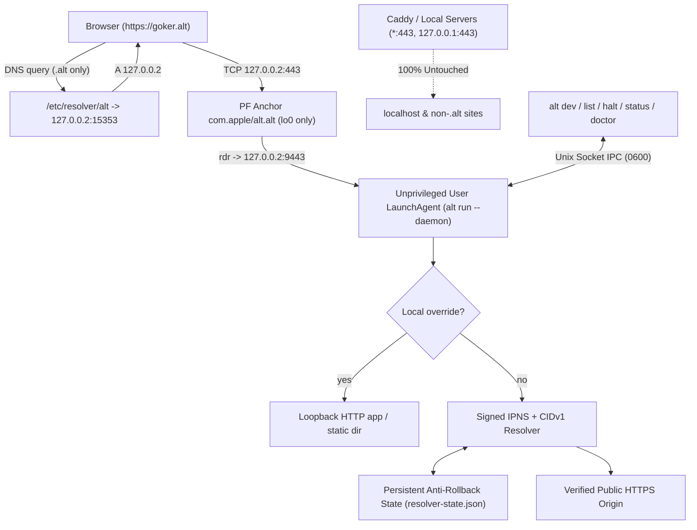

# ALT — Local-First HTTPS & Signed Namespace Resolution (`.alt`)

> **`.alt` — Local-first HTTPS development, Caddy-safe macOS port-443 integration, and cryptographically verified IPFS/IPNS domain resolution.**

ALT enables developers to open `https://<name>.alt` directly in Chrome, Safari, or Firefox — routing locally to development apps (`alt dev`) with zero account requirements, or resolving signed ownership and HTTPS target records published through the `.alt` registry and IPFS/IPNS.

The repository is built as a **reusable private-namespace engine**. `.alt` is the default official network profile (`alt-main-v1`), while independent operators can launch a separate namespace (such as `.mesh`) with its own `networkId`, Ed25519 registry authority keys, IPNS/CID root, reserved names, and trust bundle.

---

## Feature Status Matrix

| Capability | Status | Package / Command | Notes |
| --- | --- | --- | --- |
| Namespace policy & single-label validation | **Implemented** | `pkg/names` | Single source of truth for TLD and domain checks |
| Versioned network profile & signed trust-root rotation | **Implemented** | `pkg/profile`, `alt profile show\|update` | Strict YAML AST validation + monotonic `alt.profile-bundle.v1` rotation |
| Constrained device-local Root CA & SNI leaf issuance | **Implemented** | `pkg/pki` | ECDSA P-256 Root CA with critical `PermittedDNSDomains` limited to `.alt` |
| Authoritative loopback UDP DNS stub | **Implemented** | `pkg/dnsstub` | Answers configured TLD only; returns `REFUSED` for all other domains |
| Strict `alt.yaml` v1 config, router & live `SIGHUP` reload | **Implemented** | `pkg/config`, `pkg/router`, `alt dev --config`, `alt daemon reload` | Loopback-only upstreams, safe static/SPA serving, symlink-escape protection |
| Ed25519 ownership & target records (`networkId`-bound) | **Implemented** | `pkg/records` | Domain-separated signatures with `networkId` prefix + monotonic sequence |
| Mutable IPNS V2 + raw CIDv1 IPFS resolver & persistent cache | **Implemented** | `pkg/resolver` | Self-certifying `k51...` Ed25519 verification; atomic `0600` `resolver-state.json` anti-rollback across restarts |
| Persistent background daemon, `flock` lock, rotating logs & Unix IPC | **Implemented** | `pkg/daemon`, `alt daemon`, `alt dev`, `alt list`, `alt halt`, `alt status` | `0600` Unix socket control API + atomic `daemon-state.json` override store |
| macOS port-443 setup, Caddy coexistence & LaunchAgent lifecycle | **Implemented** | `pkg/sysinstall`, `sudo alt setup`, `sudo alt uninstall`, `alt doctor` | Dedicated `lo0` alias `127.0.0.2` + scoped PF anchor `com.apple/alt.alt`; leaves `*:443` / `127.0.0.1:443` untouched |
| Hosted `.alt` registry CLI (GitHub Device Flow, key proof, publish) | **Implemented** | `alt login github`, `alt register`, `alt publish`, `alt account`, `alt logout` | Keychain-backed Ed25519 owner keys; client-side signature verification |
| Universal macOS `.pkg` installer, Homebrew formula/cask & CI release | **Implemented** | `packaging/macos/build-pkg.sh`, `packaging/homebrew/`, `.goreleaser.yaml` | Universal `arm64`+`x86_64` `.pkg`, `SHA256SUMS`, Developer ID signing & notarization hooks |
| WebRTC DataChannel `net.Conn` / `net.Listener` transport | **Beta (Transport Only)** | `pkg/p2p/dcnet` | Framing and session budget implemented; end-to-end P2P target resolution & signaling are disabled in HTTPS-only v0.2 |

---

## Architecture & Caddy Coexistence Model



Why **dotALT never breaks Caddy** (or Nginx/Vite/local `:443` listeners):
1. dotALT never binds `*:443` or `127.0.0.1:443` and never runs its proxy daemon as `root`.
2. `sudo alt setup` assigns a dedicated loopback alias (`127.0.0.2`) on `lo0` and installs `/etc/resolver/alt` pointing **only** `.alt` DNS queries to `127.0.0.2:15353`.
3. A scoped macOS Packet Filter (`pf`) rule under `com.apple/alt.alt` translates `127.0.0.2:443 -> 127.0.0.2:9443` on `lo0`, where the unprivileged user `LaunchAgent` terminates TLS using your `.alt`-constrained local Root CA.
4. `sudo alt uninstall` cleanly removes the LaunchAgent, LaunchDaemon, PF anchor, `lo0` alias, `/etc/resolver/alt`, and Keychain CA certificate.

See [ARCHITECTURE.md](ARCHITECTURE.md) for security invariants and trust boundaries.

---

## Installation & Quick Start (macOS)

### Option A: Build & Install Universal `.pkg` Installer

```bash
./packaging/macos/build-pkg.sh
sudo installer -pkg dist/alt-0.2.0-darwin-universal.pkg -target /
alt doctor
```

### Option B: Build from Source & Run `sudo alt setup`

```bash
go build -o /usr/local/bin/alt ./cmd/alt
sudo alt setup
alt status
alt doctor
```

Once installed, open **`https://register.alt`** (or any published `.alt` domain such as **`https://goker.alt`**) directly in Chrome or Safari.

---

## CLI Reference

### System Integration & Daemon Management
```bash
sudo alt setup                     # Configure /etc/resolver/alt, lo0 127.0.0.2, PF 443 rule, CA trust & LaunchAgent
alt setup --dry-run                # Preview exact system files and rules without modifying macOS
sudo alt uninstall                 # Cleanly remove all OS integration (leaves Caddy and owner keys intact)
alt status [--json]                # Show live daemon, IPC, local overrides, resolver cache & IPNS watermark
alt doctor [--json]                # Verify live DNS stub, /etc/resolver/alt, CA NameConstraints & PF coexistence
alt daemon <start|stop|restart|reload|status|logs>
```

### Local Development Overrides (`alt dev`, `alt list`, `alt halt`)
Local overrides always take precedence over network records on your machine and persist across daemon restarts:
```bash
# Proxy https://goker.alt -> http://127.0.0.1:3000
alt dev goker.alt --port 3000

# Serve a static build or SPA directory over HTTPS
alt dev docs.alt --dir ./dist --spa

# Combine API proxy and frontend routes inline
alt dev app.alt --route /api/*=http://127.0.0.1:8080 --route /*=http://127.0.0.1:3000

# Load and track a multi-site alt.yaml (supports live `alt daemon reload` / SIGHUP)
alt dev --config ./alt.yaml
alt config validate ./alt.yaml

# Inspect or remove local overrides (immediately restoring IPFS/IPNS network resolution)
alt list [--json]
alt halt goker.alt
alt halt --all
```

### `.alt` Registry & Publishing (`HTTPS` Origins)
```bash
alt login github                   # Authenticate via GitHub Device Flow (stores token in macOS Keychain)
alt register goker.alt             # Generate & bind local Ed25519 owner key + verify authority certificate
alt publish goker.alt --target https://my-origin.example.com
alt account                        # Inspect bound owner key, domain generation/sequence, and IPFS/IPNS status
alt logout                         # Revoke server session and delete local token
```
> **Note on P2P:** WebRTC DataChannel framing (`pkg/p2p/dcnet`) is included at the library layer only. P2P target publishing and resolution are intentionally disabled in this HTTPS-only release.

### Trust-Root Updates, Version & Shell Completions
```bash
alt profile show [--json]
alt profile update ./signed-bundle.json
alt version [--json]
alt completion <zsh|bash|fish>
```

---

## Foreground Sandbox Mode (Zero OS Changes)

`alt run` runs entirely in the foreground on unprivileged high ports without touching `/etc`, Keychain, `pfctl`, or `launchd`:

```bash
go run ./cmd/alt run register.alt \
  --port 3000 \
  --listen 127.0.0.1:8443 \
  --dns-listen 127.0.0.1:15353 \
  --state-dir /tmp/alt-demo-state \
  --profile examples/demo-bootstrap/profile.yaml
```

---

## Verification & Testing

```bash
gofmt -l .
go vet ./...
go test -count=1 -race ./...
./packaging/macos/build-pkg.sh
```

---

## Licensing & Brand Notice

Code is licensed under [Apache-2.0](LICENSE); documentation is dual-licensed under Apache-2.0 and [CC BY 4.0](LICENSE-DOCS-CC-BY-4.0). Fork operators launching an independent namespace must generate their own `networkId`, registry authority keys, and root pointers (see [NOTICE](NOTICE)).
